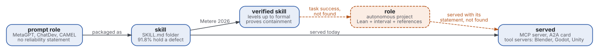

# Position

Step 4 of the review. What is known, what was not found, and what this repository asks. Each "not found" is a statement about these searches, not about the world. Terms are in [frame](frame.md).

**Shape:** [position](https://github.com/Tewf/reader-ergonomics-review/blob/39d3b25cd822a20277ee39c37b9e0130439802f2/shapes/position.md)

```dot
// Where a role sits among what the review found. Blue: found in the searches. Orange: not found in these searches.
digraph position {
  graph [rankdir=LR, nodesep=0.35, ranksep=0.55, bgcolor="white", pad=0.2, fontname="Inter"];
  node  [shape=box, style="rounded,filled", fontname="Inter", fontsize=13, margin="0.2,0.1", penwidth=1.5, fontcolor="#1F2328"];
  edge  [fontname="Inter", fontsize=11, color="#3D434B", fontcolor="#55575F", penwidth=1.3, arrowsize=0.8];
  P  [label=<<b>prompt role</b><br/><font point-size="11" color="#55575F">MetaGPT, ChatDev, CAMEL<br/>no reliability statement</font>>, fillcolor="#E8EEF8", color="#2F5DA8"];
  S  [label=<<b>skill</b><br/><font point-size="11" color="#55575F">SKILL.md folder<br/>91.8% hold a defect</font>>, fillcolor="#E8EEF8", color="#2F5DA8"];
  V  [label=<<b>verified skill</b><br/><font point-size="11" color="#55575F">levels up to formal<br/>proves containment</font>>, fillcolor="#E8EEF8", color="#2F5DA8"];
  R  [label=<<b>role</b><br/><font point-size="11" color="#55575F">autonomous project<br/>Lean + interval + references</font>>, fillcolor="#FBEDE4", color="#B4541A", style="rounded,filled,dashed"];
  M  [label=<<b>served</b><br/><font point-size="11" color="#55575F">MCP server, A2A card<br/>tool servers: Blender, Godot, Unity</font>>, fillcolor="#E8EEF8", color="#2F5DA8"];
  P -> S [label=" packaged as"];
  S -> V [label=" Metere 2026"];
  V -> R [label=" task success,\n not found", style=dashed, color="#B4541A", fontcolor="#B4541A"];
  R -> M [label=" served with its\n statement, not found", style=dashed, color="#B4541A", fontcolor="#B4541A"];
  S -> M [label=" served today"];
}
```

Graphviz source

## Known

- The field calls a role a persona in a prompt (Li 2023), a position in a team with an SOP (Hong 2023) or a skill package (Xu 2026). The packaged form has a specification and a large ecosystem (AgentSkills 2026; MCP 2026).
- The packaged form is poor: 91.8% of public skill files hold a defect (Zhang 2026), and a persona gives no measured gain on factual questions (Zheng 2024).
- Autonomy is graded by levels and kept apart from capability (Feng 2025; Zheng 2026). Loops that close from problem to result exist in a few cases (Ju 2026; Feng 2026; Yamada 2025; Novikov 2025). The problem-finding step is the weak one (Si 2024; Bisht 2026).
- A coordination of agents has a cost and a sign that depend on the task. The unchecked version amplified errors 17.2 times and a central validation contained it to 4.4 times (Kim 2025). But a verifier role that is a model approved 49% of failing submissions (Kim 2026a).
- A statistic can be pinned to a skill by a paired pass rate under deterministic verifiers (Li 2026), if the runs are repeated and the interval is stated (Bjarnason 2026; Yao 2024; Tran-Truong 2026).
- A formal level can be pinned to a skill for capability containment (Metere 2026a; Metere 2026b), and a Lean proof can close an autonomous mathematical result (Ju 2026).
- A language model needs a verifier outside itself (Kambhampati 2024), which is the structure of maths as the backbone, algorithmics as the engine and a model as the heuristic.

## Not found in these searches

- A framework among MetaGPT, ChatDev, CAMEL, AutoGen, CrewAI and OpenHands that ships a statement of reliability with its roles. The code of the six holds no file for `lean4`, `"formal verification"` or `"autonomy level"` (`search/absence.tsv`).
- A role or skill that carries together a Lean theorem about its deterministic part, a statistic with an interval on its task success, and references. Strings O9, O10, B6, B7, F7 and F11 returned the neighbours above, none with the three.
- A formal level for a skill that proves task success: the level found proves capability containment and leaves the model's freedom to refuse to act (Metere 2026b).
- An autonomy level written into a skill or role manifest and checked by a program: Feng 2025 proposes certificates and no implementation was found (strings F3, R4).
- A reliability statement in the README of the tool servers of Blender, Godot and Unity (the three READMEs, grep on six terms).
- A catalogue of roles served like MCP servers with their proofs: not searched as such. The MCP registries and the documentation sites were not read.
- None of these absences is "nobody has done this". They are what these strings found, on 2026-11-16, in arXiv, OpenAlex and the repositories named in [sources](sources.md).

## The questions

| Question | Answer from the evidence | Grade |
|---|---|---|
| Q1 What is a role and how is it packaged? | a prompt persona, a position with an SOP or a `SKILL.md` skill; only the packaged form is specified; none carries a reliability statement | descriptive |
| Q2 How is autonomy graded, and which loops close? | five levels by the person's role, kept apart from capability; closed loops in single cases; problem finding is the open step | convention for the levels, descriptive for the cases |
| Q3 What proof of reliability can be pinned to a package? | a paired pass rate with an interval, a Lean theorem or a containment proof, and references, each existing apart; none found together | supported with caveat |
| Q4 What does coordination cost, and where does the check sit? | it depends on the task; the check is a program or a validation bottleneck, not a model verifier | measured |
| Q5 How are roles packaged and served, and is there a tool role per software? | `SKILL.md` and MCP are the packaging and serving standards; Blender, Godot and Unity each have a tool server with no reliability statement | descriptive |

## What this repository asks

The reliability proof is what the searches did not find combined, and the question is whether it can be made real:

- Can a role package carry, with its definition, a **reliability statement**? It would hold a Lean theorem on the part that is mathematics, a success rate with its Wilson interval over N tasks judged by deterministic verifiers, and references. A program would check it before the role is served.
- What does the statement cover that containment does not: the task success of an autonomous project, not the bounds on what it may touch.
- Does the statement survive a change of model, or must the role be proved again for each model and harness?
- Which roles cannot be fully automated yet, and what level do they sit at: the tests are problem finding (Si 2024; Bisht 2026) and anything whose verifier is a model (Kim 2026a)?

## What the shapes must decide

- The manifest of a role: whether it extends `SKILL.md` and the verification levels of Metere 2026a, or states its own, and where the autonomy level and the proof fields go.
- The unit of proof: a pass rate with a Wilson interval over N tasks and k repeats, against the single agent as comparator (the pilot role of the DAG, task `f-pilot-role`).
- The check at the centre: a program runs the proof's checks at the serving step, not a model (Kim 2025; Kim 2026a).
- The name `Tewf/roles`: kept, with the definition of this review in its first lines, or renamed (the frame says the field's closest word is a skill with a verification level above `tested`).
